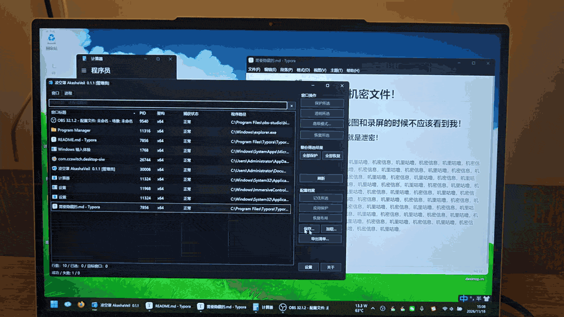
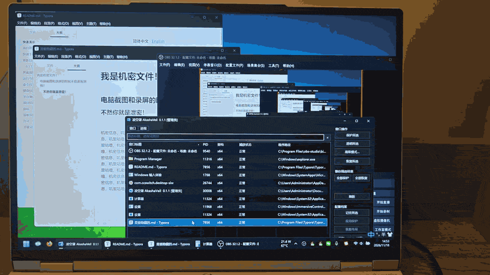
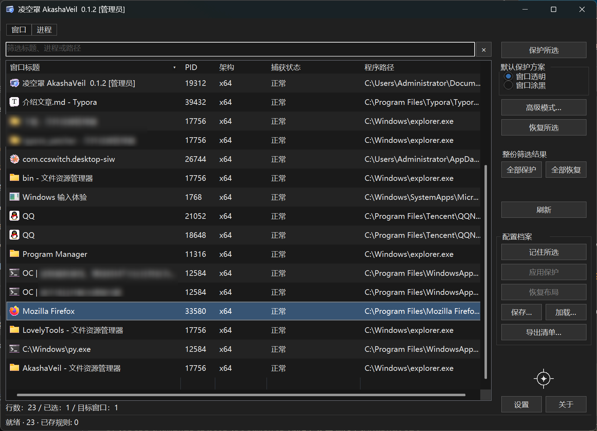
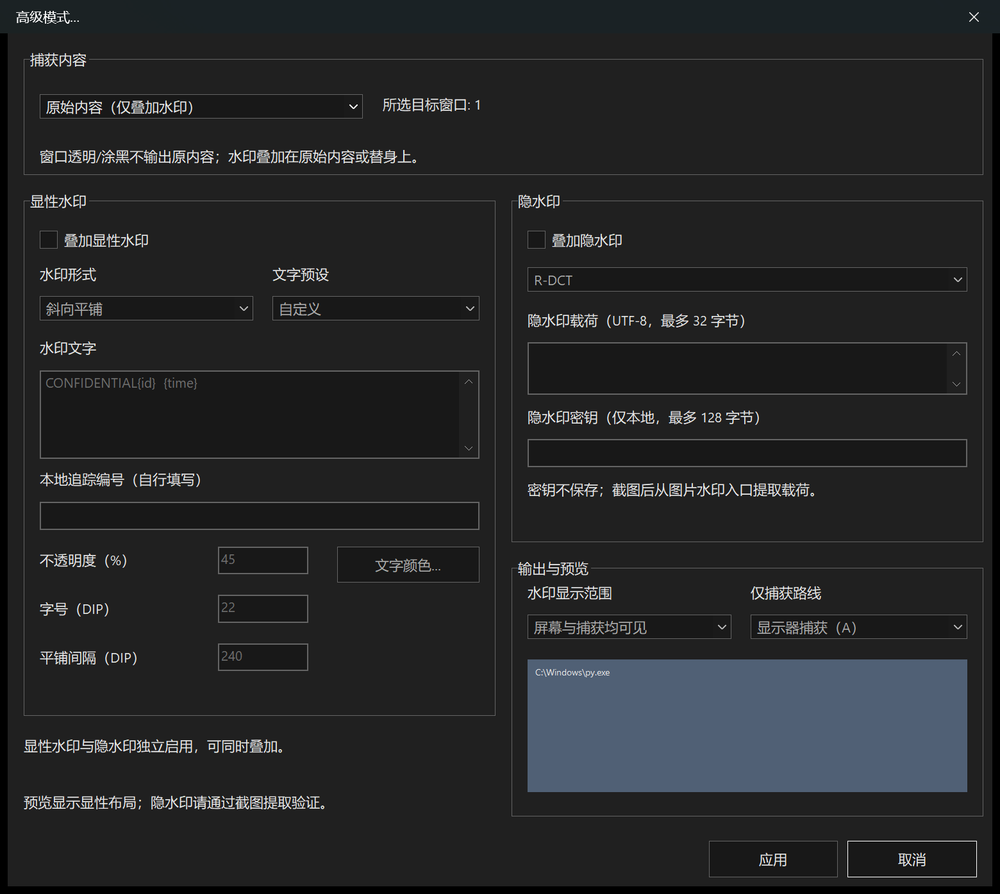
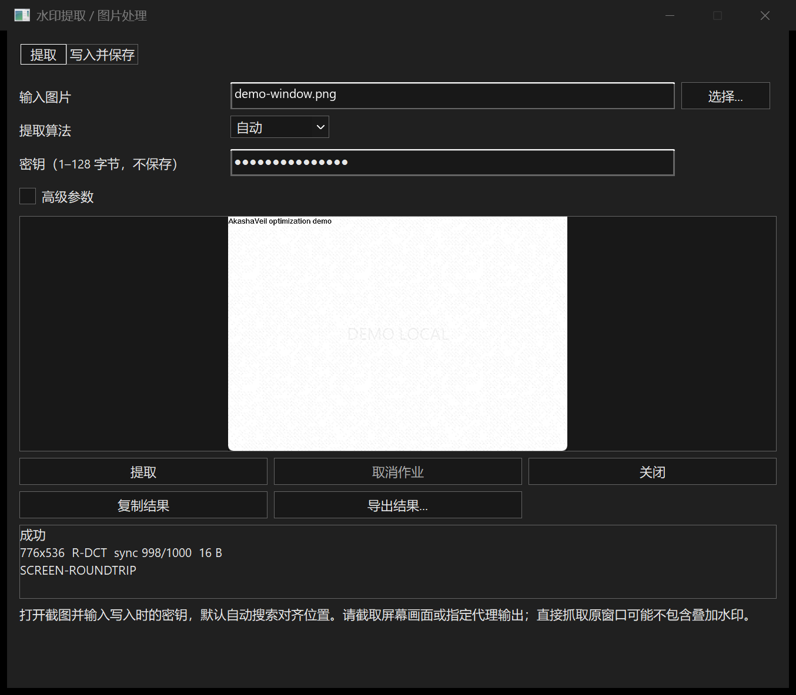
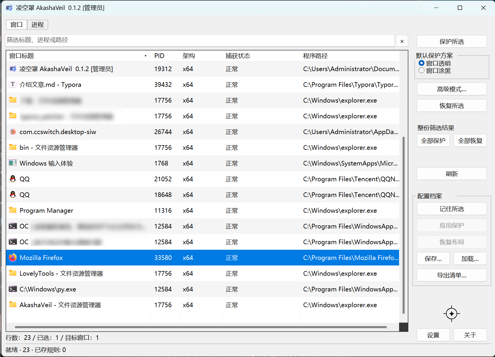

<p align="center"><b>简体中文</b> · <a href="README_EN.md">English</a></p>

<p align="center"></p>

<h1 align="center">凌空罩 · AkashaVeil</h1>

<p align="center"><b>让选中的窗口在截图和录屏里消失，或者给它加上水印。</b><br/>纯本地运行，单个 EXE，不联网、不上传。</p>

<p align="center">
  <a href="https://github.com/Henglie/AkashaVeil/stargazers"></a>
  <a href="LICENSE"></a>
  <a href="https://github.com/Henglie/AkashaVeil/releases"></a>
  <a href="https://github.com/Henglie/AkashaVeil/issues"></a>
</p>

> [!WARNING]
> 本工具仅用于自用**防截图/防录屏**与追踪水印附加的正当用途。
> 请勿把它用于**反监视、反反作弊**或任何违法违规场景；使用者需自行承担不当使用产生的一切后果。本工具属于技术中立，假如你真的在违法犯罪活动中应用了该工具，由于项目未做针对性功能，故不受牵连，作者及其项目贡献者不承担任何责任。
> 防捕获效果最终取决于DWM与具体捕获后端（OBS、会议共享、桌面捕获等），请以实际截图/录像为准。

## 快速演示

**截图时，窗口直接消失：**



**录屏时，窗口不会出现在画面里：**



## 它能做什么

- 在窗口列表里选中目标，点一下“保护所选”，这个窗口就会从截图和录屏中排除。
- 保护方式有两种：**窗口透明**（只留下背景）和**窗口涂黑**（变成黑块）。默认是窗口透明，在右侧“默认保护方案”里直接改。
- 不想翻列表？按住“设置 / 关于”上方的瞄准图标，拖到目标窗口上松开，直接选中。
- 高级模式里还能把捕获画面换成纯色或文字占位，叠加显性水印、写入隐水印。
- 支持窗口规则、自动保护、托盘、九种界面语言和明暗主题。

## 快速下载

当前发布版本：**v0.1.2**。下载后直接运行，不需要安装 Python、Qt 或运行库。

| 下载 | 说明 |
|---|---|
| [百度网盘](https://pan.baidu.com/s/1mmNK-2tSO4c_0qTj_HCILA?pwd=0000) | 提取码 `0000` |
| [夸克网盘](https://pan.quark.cn/s/b0bc1b050888) | 国内备用，打开后选择版本下载 |
| [AkashaVeil-x64.exe](https://github.com/Henglie/AkashaVeil/releases/download/v0.1.2/AkashaVeil-x64.exe) | 普通 Intel / AMD 64 位 Windows，优先选这个 |
| [AkashaVeil-x86.exe](https://github.com/Henglie/AkashaVeil/releases/download/v0.1.2/AkashaVeil-x86.exe) | 32 位 Windows，也能在 64 位 Windows 上跑 |
| [AkashaVeil-arm64.exe](https://github.com/Henglie/AkashaVeil/releases/download/v0.1.2/AkashaVeil-arm64.exe) | Windows on ARM |
| [完整压缩包](https://github.com/Henglie/AkashaVeil/releases/download/v0.1.2/AkashaVeil-0.1.2-windows-all.zip) | 三种架构、离线文档、许可和校验和 |
| [SHA256SUMS.txt](https://github.com/Henglie/AkashaVeil/releases/download/v0.1.2/SHA256SUMS.txt) | 文件校验值，介意完整性可以核对 |

[所有发行版本](https://github.com/Henglie/AkashaVeil/releases) · [源码仓库](https://github.com/Henglie/AkashaVeil)

## 怎么用

1. 打开凌空罩。
2. 在列表里选窗口，或者按住“设置 / 关于”上方的瞄准图标拖到目标窗口。
3. 点**“保护所选”**。
4. 打开截图或录屏软件，实际看一眼效果。
5. 不想要保护了，点“恢复所选”。

若要将已保护的窗口从涂黑改为透明，在主窗口右侧的 **默认保护方案** 中选择“窗口透明”，再对目标窗口点击“保护所选”。

需要更复杂的效果，选中窗口后点 **“高级模式…”**。可以把画面换成纯色或文字，也可以加水印。改完点“应用”，再实际截图确认。

## 效果预览

<p align="center"></p>

| 高级模式 | 图片隐水印 |
|---|---|
|  |  |

<details>
<summary>查看明色主题</summary>



</details>

## 更新日志

### 0.1.2

- 主界面合并为一个“保护所选”；在右侧“默认保护方案”中选择窗口透明或窗口涂黑。
- 新增瞄准图标：位于“设置 / 关于”上方居中，悬停有提示，按住拖到目标窗口松开即选中。
- 修复高级模式切换捕获内容后，右上角“所选目标窗口 / 替身文字 / 替身颜色”叠在一起的问题；减少不必要的重画。
- 优化主窗口拖动缩放，最小高度按新版布局计算。
- 公开源码默认包含投喂图片，构建时自动嵌入。
- 重写 README 和介绍文章，加入演示 GIF、网盘入口和 Linux.do 社区。

完整历史见 [CHANGELOG.md](CHANGELOG.md)。

## 平台与限制

- Windows 7 起分级支持，推荐 Windows 10 2004+ / Windows 11。
- 三种架构都有独立 EXE；ARM64 和 Windows 7 没有完整真机验证记录。
- 不同截图/录屏软件的结果可能不同，OBS、会议共享、窗口捕获等请分别实测。
- 手机拍屏、打印扫描、任意旋转或透视后的隐水印提取不作保证。

## 从源码构建

需要 Visual Studio 的 C++ 桌面工具链（x86 / x64 / ARM64）、CMake 和 Ninja。

```powershell
./tools/build.ps1 -Architecture all -Configuration Release
```

产物在 `build/standalone/`：`AkashaVeil-x86.exe`、`AkashaVeil-x64.exe`、`AkashaVeil-arm64.exe`。三份文件各自独立，静态 CRT，运行只依赖系统 DLL。

## 命令行

图形界面之外也支持脚本调用：

```text
AkashaVeil list [--json]
AkashaVeil protect --process <PID> [--json]
AkashaVeil protect --window  <HWND> [--json]
AkashaVeil restore --process <PID> [--json]
AkashaVeil restore --window  <HWND> [--json]
AkashaVeil --version [--json]
AkashaVeil --profile <配置文件>
```

完整参数、退出码和 JSON 字段见 [命令行文档](docs/CLI.md)。

## 隐私

- 程序运行纯本地：不联网、不上传、不采集遥测、不采集设备指纹。
- 窗口和进程信息、配置只留在本机；隐水印密钥不会写进配置文件。
- 投喂图片随程序一起提供，构建时嵌入 EXE，不包含私人路径或联系方式。

## 社区

本项目认可 [Linux.do 社区](https://linux.do)。

## 说明文档与反馈

- [文档导航](docs/README.md) · [使用指南](docs/USER_GUIDE.md)
- [命令行与 JSON](docs/CLI.md) · [常见问题](docs/FAQ.md)
- [功能介绍文章](介绍文章.md) · [贡献说明](CONTRIBUTING.md) · [发布清单](发布清单.md)
- 问题反馈：[GitHub Issues](https://github.com/Henglie/AkashaVeil/issues)。请附版本、系统、截图/录屏方式、复现步骤和实际结果，提交前遮掉私人窗口标题、路径和水印密钥。

## 许可

本项目采用 **Apache License 2.0**，可自由使用、修改与再分发，详见 [LICENSE](LICENSE)。

- 作者：恒烈 / Henglie / EternalBlaze。
- 非营利项目；投喂入口在程序“关于”页。
- Copyright 2026 Henglie.
