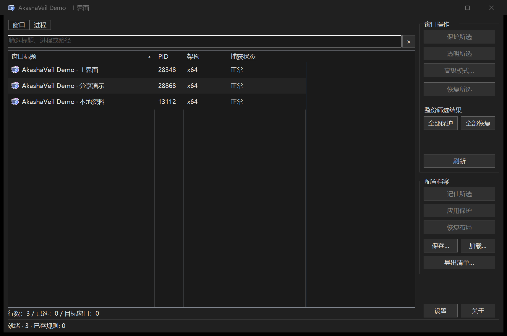
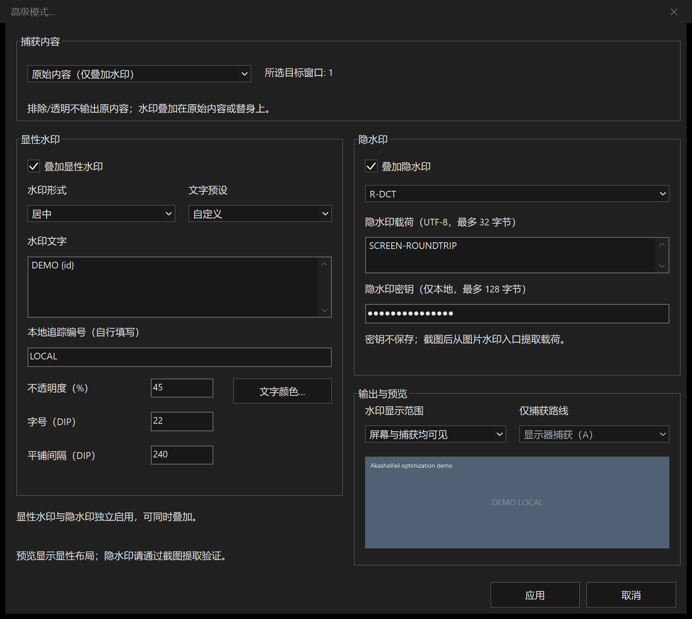
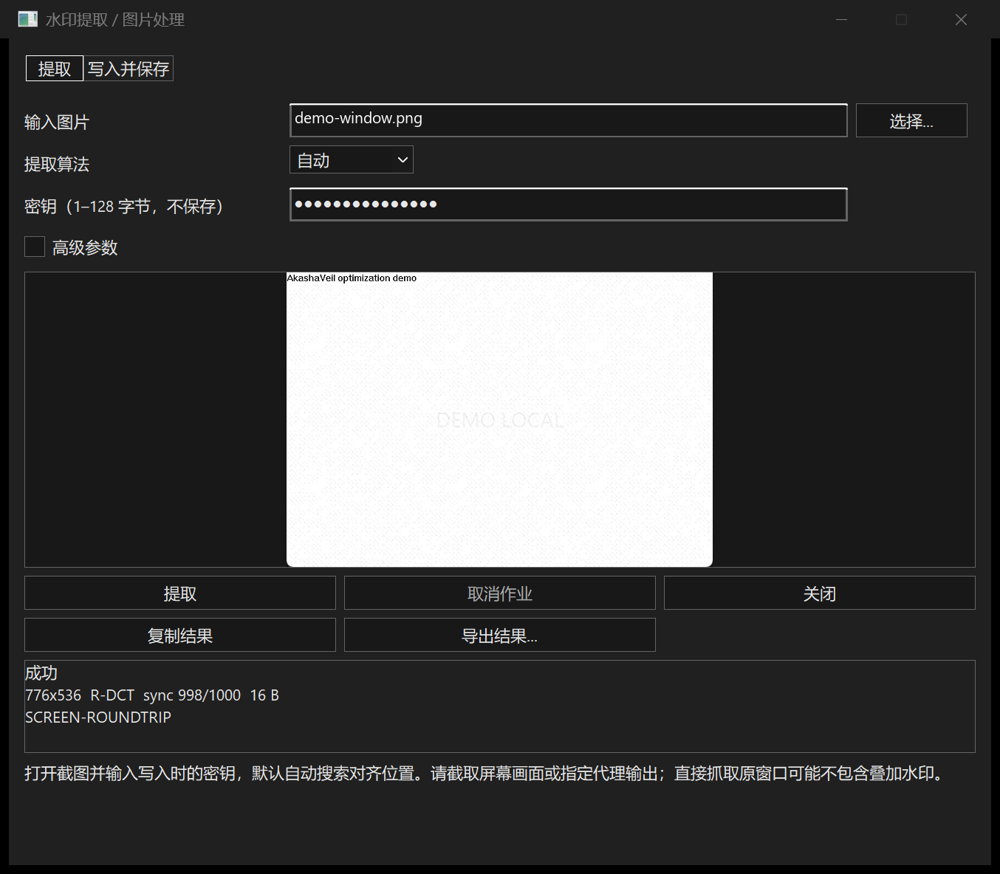
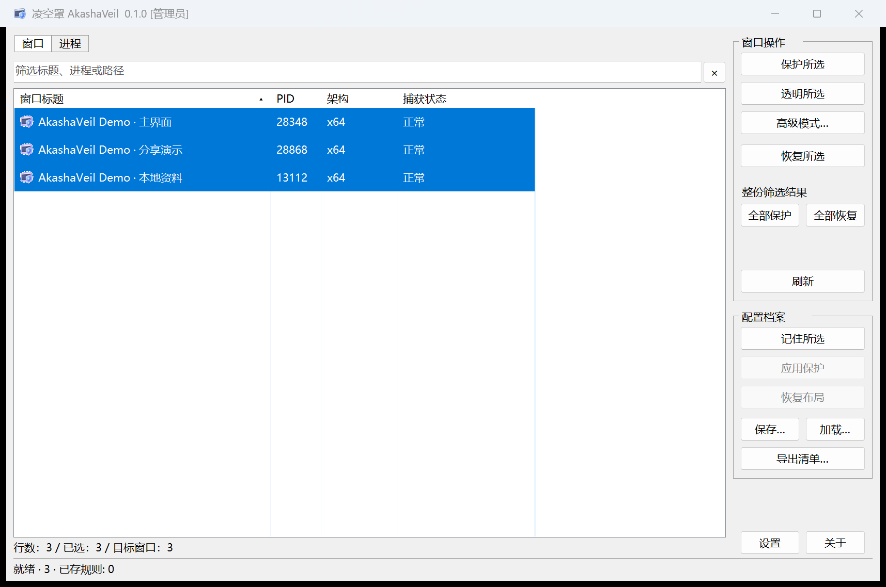

<p align="center"><b>简体中文</b> · <a href="README_EN.md">English</a></p>

<p align="center"></p>

<h1 align="center">凌空罩 · AkashaVeil</h1>

<p align="center">
  <b>纯本地的 Windows 窗口防捕获与水印管理工具</b><br/>
  为选定窗口设置捕获保护、透明或恢复，按需叠加显性 / 隐性水印；不联网、不上传、不采集。
</p>

<p align="center">
  <a href="https://github.com/Henglie/AkashaVeil/stargazers"></a>
  <a href="LICENSE"></a>
  <a href="https://github.com/Henglie/AkashaVeil/releases"></a>
  <a href="https://github.com/Henglie/AkashaVeil/issues"></a>
</p>

> [!NOTE]
> 凌空罩全程在本机运行：不联网、不上传、不采集遥测、不采集设备指纹。窗口与进程元信息、你的配置与水印载荷只保存在本地。

> [!WARNING]
> 本工具仅用于你在自有设备、自有窗口上做防截图 / 防录屏与追踪水印的正当用途。请勿把它用于侵犯他人隐私或任何违法违规场景；使用者需自行承担不当使用产生的一切后果。防捕获效果最终取决于 DWM 与具体捕获后端（OBS、会议共享、桌面捕获等），请以实际截图 / 录像为准。

## 目录

- [快速下载](#快速下载)
- [更新日志](#更新日志)
- [项目简介](#项目简介)
- [特点](#特点)
- [界面预览](#界面预览)
- [运行与构建](#运行与构建)
- [命令行](#命令行)
- [键盘快捷键](#键盘快捷键)
- [平台兼容性](#平台兼容性)
- [项目结构](#项目结构)
- [使用](#使用)
- [隐私](#隐私)
- [说明文档与反馈](#说明文档与反馈)
- [许可](#许可)
- [关键词 / Keywords](#关键词--keywords)

## 快速下载

当前版本：**v0.1.1**。下载后直接运行对应架构的 EXE，无需安装 Python、Qt 或额外运行库。

| 下载 | 适用平台 |
|---|---|
| [AkashaVeil-x64.exe](https://github.com/Henglie/AkashaVeil/releases/download/v0.1.1/AkashaVeil-x64.exe) | 普通 Intel / AMD 64 位 Windows，优先选此项 |
| [AkashaVeil-x86.exe](https://github.com/Henglie/AkashaVeil/releases/download/v0.1.1/AkashaVeil-x86.exe) | 32 位 Windows；也可在 x64 Windows 运行 |
| [AkashaVeil-arm64.exe](https://github.com/Henglie/AkashaVeil/releases/download/v0.1.1/AkashaVeil-arm64.exe) | Windows on ARM |
| [完整压缩包](https://github.com/Henglie/AkashaVeil/releases/download/v0.1.1/AkashaVeil-0.1.1-windows-all.zip) | 三架构 EXE、离线文档、许可与校验和 |
| [SHA256SUMS.txt](https://github.com/Henglie/AkashaVeil/releases/download/v0.1.1/SHA256SUMS.txt) | 发布文件的 SHA-256 校验和 |

[所有发行版本](https://github.com/Henglie/AkashaVeil/releases) · [源码仓库](https://github.com/Henglie/AkashaVeil)

国内下载：[夸克网盘](https://pan.quark.cn/s/b0bc1b050888) · [百度网盘](https://pan.baidu.com/s/1mmNK-2tSO4c_0qTj_HCILA?pwd=0000)（提取码：`0000`）。下载后可用对应版本的 `SHA256SUMS.txt` 核对文件。

## 更新日志

### 0.1.1

- 新增 R-DCT：分布式密钥导频、字节空间交织、软判决和 RS 错误/擦除纠错，增强压缩、裁剪后的提取。
- 接入图片水印、高级模式与捕获合成，保留 DCT / DWT 兼容、九语与轻量单 EXE。
- 增加夸克 / 百度网盘下载入口，补齐参数、画质取舍与鲁棒性边界说明。
- 修复关于页编辑框鼠标滑动时闪烁。
- 高级功能按四组重排，显隐水印独立叠加；提取与写入分开，默认自动对齐。修复真实截图中的图层顺序和客户区缩放问题。

完整历史见 [CHANGELOG.md](CHANGELOG.md)。

## 项目简介

**凌空罩**（**AkashaVeil**，Akasha 意为虚空、Veil 意为帷幕）是一个 Windows 桌面专用的本地窗口防捕获与水印管理工具，面向希望给窗口做"防截图 / 防录屏"和追踪水印的普通电脑用户。

你可以枚举本机的窗口与进程并多选，对选中对象设置三种捕获状态：

- **保护**：把窗口从捕获中排除（`WDA_EXCLUDEFROMCAPTURE`，Windows 10 2004 起；Windows 7 走 `WDA_MONITOR`，语义不同）。
- **透明**：请求系统隐藏被捕获的窗口内容；捕获结果可能是空白或黑色，取决于系统与后端。本机窗口仍保持可见。
- **恢复**：移除保护与图层，回到原始捕获状态。

工具会从系统读回窗口真实的捕获亲和性并如实显示，不会把失败行标成保护成功。

除基础保护外，还有**高级模式**：编辑捕获内容（原始内容 / 排除 / 透明 / 纯色替身 / 文字占位）、叠加显性水印、写入与提取隐性水印、生成"仅捕获"可见的替身内容。

## 特点

- **纯本地 · 零外发**：不联网、不上传、不采集遥测、不采集设备指纹，所有处理在本机完成。
- **三架构单 EXE**：x86 / x64 / ARM64 三个独立单文件，静态 CRT，运行只依赖 Windows 系统 DLL，辅助模块内嵌，分发目录只需一个 EXE。
- **窗口 / 进程双视图**：应用图标、隔行底色与宽行距、名称 / 路径 / PID 筛选、列排序、原生多选；各视图独立保留筛选，刷新保留选择、焦点与滚动位置。
- **保护 / 透明 / 恢复**：对所选窗口一键切换；x86 / x64 同位数与跨位数调用均已通过受控测试。
- **高级模式**：
  - 捕获内容：原始内容、排除、透明、纯色替身、文字占位。
  - 显性水印：斜向平铺、居中、右下角标三种形式，可调不透明度、字号、间隔与颜色。
  - 显示范围：屏幕与捕获均可见、仅捕获可见。
  - 预设与字段：内置预设，支持 `{title}`、`{process}`、`{pid}`、`{time}`、`{id}` 字段，并带捕获预览。
- **隐性水印**：R-DCT 增强路线、DCT（QIM）与 DWT（Haar LH3）写入 / 提取，本地图片水印，32 字节载荷与本地密钥；显性与隐性可组合。R-DCT 使用分布式同步、空间交织和软判决纠错；画质与鲁棒性存在取舍，见[隐水印说明](docs/WATERMARK.md)。
- **仅捕获替换路线（A / B）**：A 配合显示器捕获，B 提供可选择的受控捕获源窗口；不修改录屏或会议软件。纯色替身与仅捕获模式属于实验性桌面合成能力。
- **档案**：保存 / 加载窗口规则、程序名单、布局与状态；重启后按精确身份重新匹配并恢复；CSV 元信息导出。
- **偏好与自动化**：自动刷新、按规则 / 程序名单自动保护、就绪失败重试上限、托盘、关闭收起到托盘、隐藏本工具任务栏按钮、标题 / 托盘图标 / 提示随机化。
- **九语界面**：简体中文、英语、西班牙语、法语、俄语、阿拉伯语、土耳其语、日语、韩语；阿拉伯语 RTL；缺译回退英语；繁体中文系统默认英语。明暗 / 系统主题与主题色可调。
- **命令行**：`list` / `protect` / `restore` / `--version`，支持 `--json`，便于脚本与 AI 调用。

## 界面预览

截图使用演示窗口，主列表中的可执行文件路径列已折叠，图片处理中的文件路径已脱敏。

<p align="center"></p>

| 高级模式 | 图片隐水印 |
|---|---|
|  |  |

<details>
<summary>查看明色主题</summary>



</details>

## 运行与构建

需要 Visual Studio 的 C++ 桌面工具链（x86 / x64 / ARM64）、CMake 和 Ninja。辅助模块由同一份源码分别编译并嵌入 EXE 资源，不需要额外运行时。

```powershell
./tools/build.ps1 -Architecture all -Configuration Release
```

单文件输出位于 `build/standalone/`：

| 架构 | 文件 |
|---|---|
| x86 | `AkashaVeil-x86.exe` |
| x64 | `AkashaVeil-x64.exe` |
| ARM64 | `AkashaVeil-arm64.exe` |

三份产物各自独立、可单独复制运行，采用静态 CRT，运行只依赖系统的 Windows DLL。跨进程保护所需的自有辅助模块已包含在 EXE 内，使用时按需释放到 `%LOCALAPPDATA%/AkashaVeil/Runtime/`；缓存按模块内容区分，使用前校验字节并保持只读锁，重复运行复用缓存，损坏缓存会保留备份并由内嵌资源修复。当前源码构建版本 **0.1.1**。

公开源码默认不包含投喂图片；如持有产品负责人批准的私有图片，可追加 `-ContributionAsset <图片路径>` 将其嵌入关于页投喂入口。未提供时关于页显示缺失提示，不影响其他功能。

本地构建入口：`build/standalone/AkashaVeil-x64.exe`。公开源码可独立构建，默认不构建可选验证目标。

指定独立配置可使用 `AkashaVeil.exe --profile <配置文件>`；普通模式使用 `%APPDATA%/AkashaVeil/profile.ini`，程序目录存在 `portable.ini` 时使用同目录配置。

## 命令行

除图形界面外，程序可直接以命令行调用，便于脚本与自动化集成：

```text
AkashaVeil list [--json]
AkashaVeil protect --process <PID> [--json]
AkashaVeil protect --window  <HWND> [--json]
AkashaVeil restore --process <PID> [--json]
AkashaVeil restore --window  <HWND> [--json]
AkashaVeil --version [--json]
AkashaVeil --profile <配置文件>
```

| 命令 | 说明 |
|---|---|
| `list` | 列出当前顶层窗口及所属进程信息；每条记录对应一个窗口 |
| `protect` | 对指定进程（`--process <PID>`）或窗口（`--window <HWND>`）应用保护 |
| `restore` | 对指定目标恢复原始捕获状态 |
| `hide` / `unhide` | `protect` / `restore` 的别名 |
| `--version` | 输出版本信息 |
| `--json` | 以 JSON 输出，便于程序解析 |
| `--profile <文件>` | 使用指定配置文件 |

退出码：

| 码 | 含义 |
|---:|---|
| 0 | 成功 |
| 2 | 语法错误 |
| 3 | 无目标 |
| 4 | 部分失败 |
| 5 | 全部失败 |
| 6 | 超时或取消 |

## 键盘快捷键

| 快捷键 | 作用 |
|---|---|
| `Ctrl+H` | 保护所选 |
| `Ctrl+U` | 恢复所选 |
| `Ctrl+A` | 列表获得焦点时全选 |
| `Ctrl+S` | 保存配置 |
| `Ctrl+O` | 加载配置 |
| `Ctrl+E` | 导出清单 |
| `Ctrl+P` | 偏好设置 |
| `Ctrl+W` | 打开高级模式 |
| `Ctrl+F` | 筛选 |
| `Ctrl+R` / `F5` | 刷新 |
| `Esc` | 筛选框获得焦点时清空；对话框中取消 / 关闭 |
| `F1` | 帮助 |

## 平台兼容性

专为 Windows 桌面设计，Windows 7 起分级支持：

| 架构 | 产物 | 说明 |
|---|---|---|
| x86 | `AkashaVeil-x86.exe` | 单文件，兼容 32 位与 64 位 Windows |
| x64 | `AkashaVeil-x64.exe` | 单文件，主平台 |
| ARM64 | `AkashaVeil-arm64.exe` | 单文件，Windows on ARM |

说明：

- `WDA_EXCLUDEFROMCAPTURE` 从 Windows 10 2004 起提供；Windows 7 按 `WDA_MONITOR` 处理，语义不同。
- 防捕获效果依赖 DWM 与捕获后端，桌面 BitBlt 的受控测试不代表 OBS、会议共享、窗口捕获、独占全屏等后端已通过。
- Windows 7 / ARM64 的本版产物没有完整目标真机验证记录；建议优先在 Windows 10 2004+ / Windows 11 使用，并以目标环境的实际结果为准。
- 已验证受控带标题栏窗口的桌面截图→GUI 提取，以及本地图片链路。直接抓取原窗口可能漏掉叠层；OBS、会议视频、手机拍屏和任意变换的恢复不作保证。

## 项目结构

```
src/core/               不依赖 GUI 的记录、档案模型与语言选择
src/platform/windows/   窗口枚举、持久化、显示亲和性、辅助模块缓存、图层
src/app/                Win32 GUI；用户文案走语言 key
src/helper/             按目标架构编译的短时窗口钩子辅助模块
tools/build.ps1         从 vswhere 探测工具链并构建三架构单文件
tools/package.ps1       按机器白名单生成源码快照与完整发行包
tools/verify-release.ps1 核对发行集合、校验和及归档内容
docs/                   使用指南、命令行、常见问题与界面图片
CMakeLists.txt          版本单源、资源内嵌与构建配置
```

## 使用

1. 打开程序，左侧列出本机窗口与进程，可按名称 / 路径 / PID 筛选、排序并多选。
2. 对选中对象点击**保护**、**透明**或**恢复**；也可用 `Ctrl+H` / `Ctrl+U` 快捷操作。
3. 需要水印时点击**高级模式**（或 `Ctrl+W`）：选择捕获内容、水印形式与显示范围，编辑文字并查看预览，然后应用。
4. 点击**记住所选**保存该对象的模式与水印；可将规则、名单、布局与状态保存为配置文件，之后加载并按精确身份重新匹配、一键恢复布局。
5. 偏好设置里可开启自动刷新、按规则 / 程序名单自动保护、托盘、关闭收起等；自动保护与自动刷新默认关闭，按需开启。

默认显示托盘图标，关闭窗口时收起到托盘；通过设置菜单或托盘菜单的**退出**结束程序。

## 隐私

- 程序运行**纯本地**：不联网、不上传、不采集遥测、不采集设备指纹。
- 窗口 / 进程元信息与用户配置仅用于本机管理，不会外发；隐水印密钥仅用于当前操作，不写入配置文件。
- 不做联网追溯、不建账号系统、不接入云端。
- 投喂（赞助）入口使用产品负责人指定的本地图片；该图片仅随私有构建内嵌，公开源码不含私有路径或联系方式。
- 关于页显示仓库地址，并提供 `GitHub` 按钮。只有主动点击时才交给系统默认浏览器打开网页，应用没有后台联网或自动更新。

## 说明文档与反馈

- [文档导航](docs/README.md) · [使用指南](docs/USER_GUIDE.md)
- [命令行与 JSON](docs/CLI.md) · [常见问题](docs/FAQ.md)
- [功能介绍文章](介绍文章.md) · [贡献说明](CONTRIBUTING.md) · [发布清单](发布清单.md)
- 问题反馈：[GitHub Issues](https://github.com/Henglie/AkashaVeil/issues)。请附版本、系统、捕获方式、复现步骤和实际结果，提交前遮盖私人窗口标题、路径和水印密钥。

## 许可

本项目采用 **Apache License 2.0**，可自由使用、修改与再分发，详见 [LICENSE](LICENSE)。

- 作者：恒烈 / Henglie / EternalBlaze。
- 非营利项目；投喂入口见程序「关于」页。
- Copyright 2026 Henglie.

完整历史见 [CHANGELOG.md](CHANGELOG.md)；功能长文见 [介绍文章.md](介绍文章.md)。

## 关键词 / Keywords

凌空罩, AkashaVeil, 窗口防捕获, 防截图, 防录屏, 窗口排除, 透明窗口, 屏幕水印, 显性水印, 隐性水印, 盲水印, DCT, DWT, QIM, WDA_EXCLUDEFROMCAPTURE, WDA_MONITOR, SetWindowDisplayAffinity, Windows, Win32, 单文件, 三架构, x86, x64, ARM64, 九语, RTL, 命令行, CLI, 隐私, 纯本地, Apache-2.0, window anti-capture, screen watermark, screen capture exclusion, Windows desktop.
