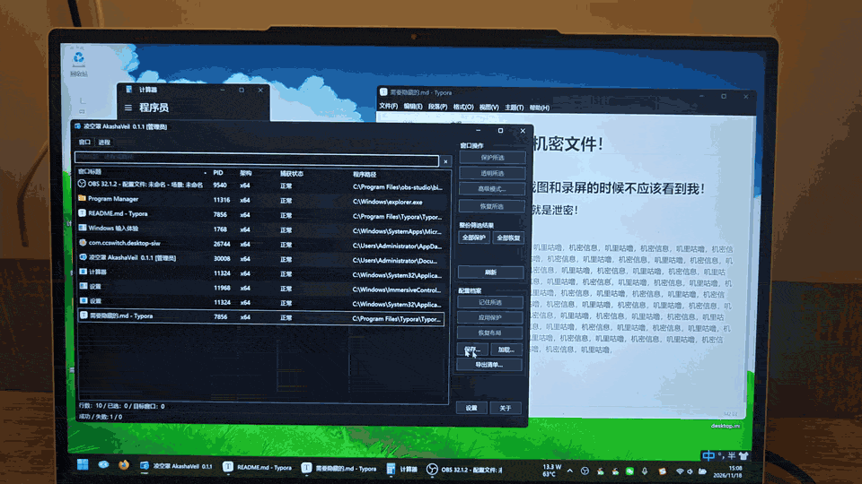
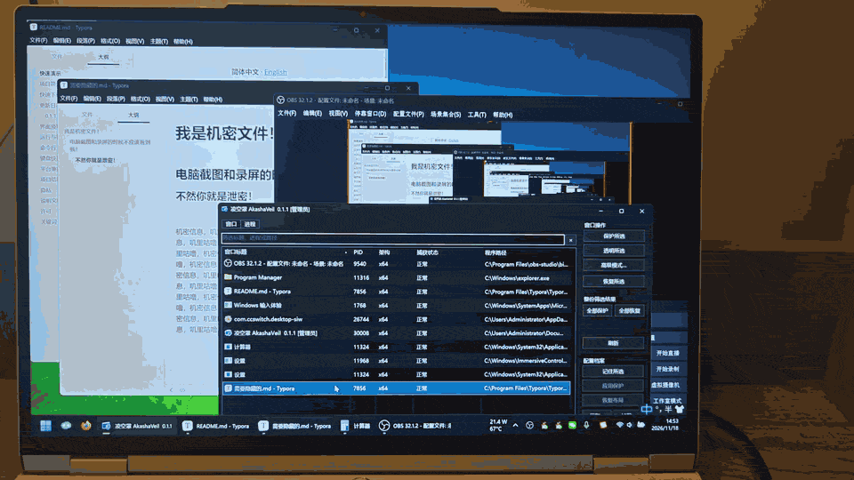
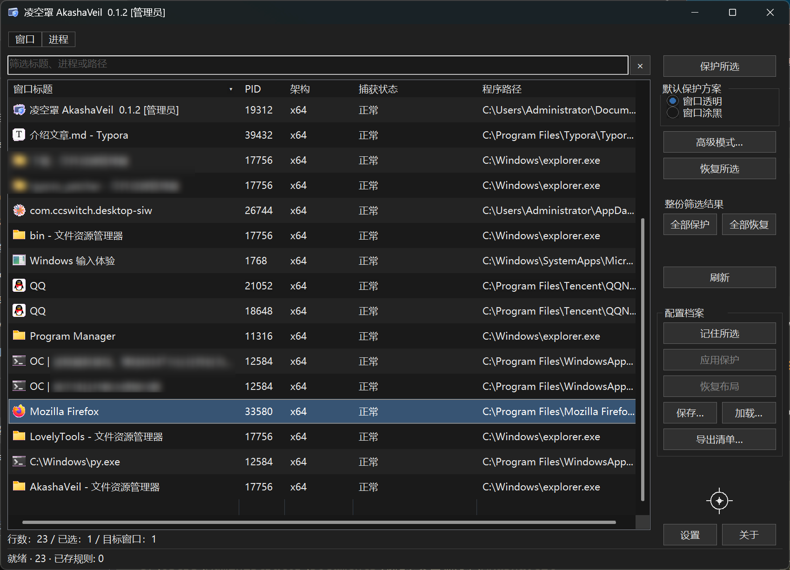
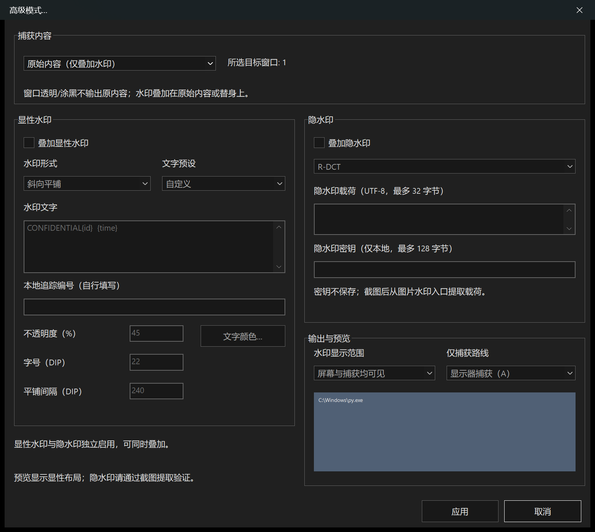
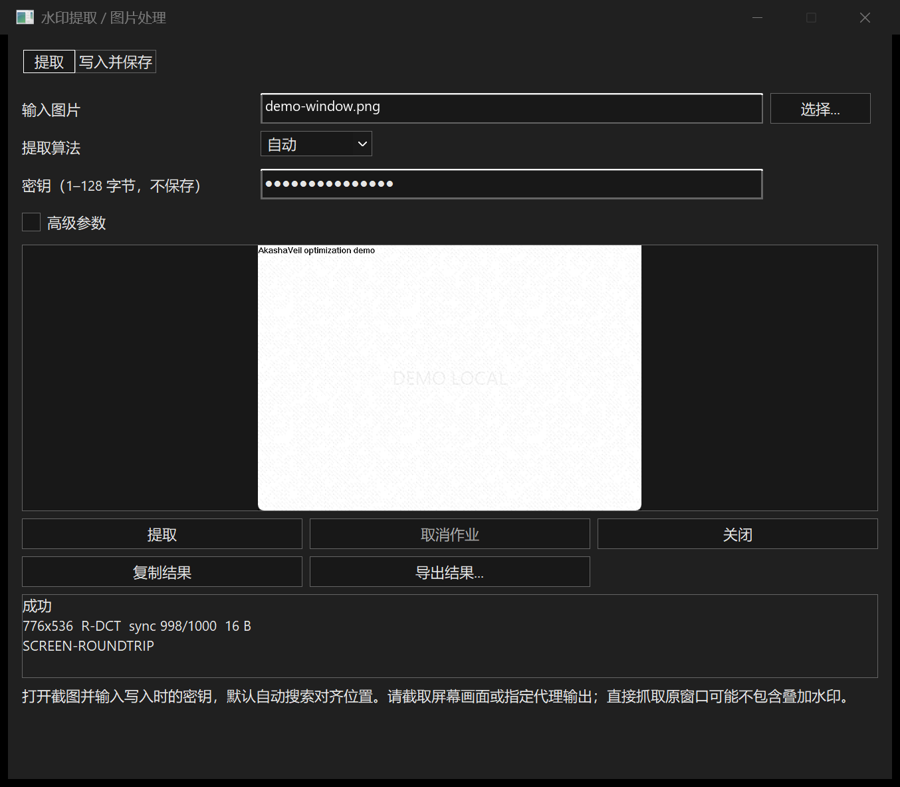

<p align="center"><a href="README.md">简体中文</a> · <b>English</b></p>

<p align="center"></p>

<h1 align="center">AkashaVeil · 凌空罩</h1>

<p align="center"><b>Make a window disappear from screenshots and recordings — or put a watermark on it.</b><br/>Runs entirely on your PC. One EXE. No network, no uploads.</p>

<p align="center">
  <a href="https://github.com/Henglie/AkashaVeil/releases"></a>
  <a href="LICENSE"></a>
  <a href="https://github.com/Henglie/AkashaVeil/stargazers"></a>
</p>

> [!WARNING]
> Use it only on devices and windows you are allowed to manage. Results depend on Windows and on the capture app. Check a real screenshot or recording before relying on it.

## Demo

**The window disappears from a screenshot:**



**The window stays out of a screen recording:**



## What it does

- Select a window, click **Protect selected**, and it is excluded from screenshots and recordings.
- Choose **Window transparent** (background only) or **Window blacked out** (black block). Transparent is the default; change it in the **Default protection scheme** group on the main window.
- Drag the aim icon above **Settings / About** onto a window and release to select it without searching the list.
- Advanced mode can replace captured content with a solid color or text, add a visible watermark, or embed a hidden watermark.
- Rules, automatic protection, tray mode, nine UI languages, and light/dark themes are included.

## Download

Current release: **v0.1.2**. Each EXE runs directly; no installer, Python, Qt, or runtime is required.

| Download | Notes |
|---|---|
| [Baidu Netdisk](https://pan.baidu.com/s/1mmNK-2tSO4c_0qTj_HCILA?pwd=0000) | Access code `0000` |
| [Quark Drive](https://pan.quark.cn/s/b0bc1b050888) | Backup mirror for users in China |
| [AkashaVeil-x64.exe](https://github.com/Henglie/AkashaVeil/releases/download/v0.1.2/AkashaVeil-x64.exe) | Most Intel / AMD 64-bit PCs |
| [AkashaVeil-x86.exe](https://github.com/Henglie/AkashaVeil/releases/download/v0.1.2/AkashaVeil-x86.exe) | 32-bit Windows; also runs on 64-bit Windows |
| [AkashaVeil-arm64.exe](https://github.com/Henglie/AkashaVeil/releases/download/v0.1.2/AkashaVeil-arm64.exe) | Windows on ARM |
| [Complete ZIP](https://github.com/Henglie/AkashaVeil/releases/download/v0.1.2/AkashaVeil-0.1.2-windows-all.zip) | All architectures, offline docs, license, and checksums |
| [SHA256SUMS.txt](https://github.com/Henglie/AkashaVeil/releases/download/v0.1.2/SHA256SUMS.txt) | Checksums for release files |

[All releases](https://github.com/Henglie/AkashaVeil/releases) · [Source repository](https://github.com/Henglie/AkashaVeil)

## How to use

1. Open the app and select a window in the list. Or drag the aim icon above **Settings / About** onto the target window.
2. Click **Protect selected**. The default scheme is **Window transparent**; switch to **Window blacked out** in the **Default protection scheme** group on the main window.
3. Take a screenshot or record your screen with the app you normally use, and check the result.
4. Select the window and click **Restore selected** when you no longer need protection.

To change the scheme for a window that is already protected, choose the new scheme on the main window and click **Protect selected** again.

For replacement content or watermarks, select a window and open **Advanced mode**. Apply the settings, then verify with a real screenshot.

## Screenshots

<p align="center"></p>

| Advanced mode | Image watermark |
|---|---|
|  |  |

[Light theme](docs/images/main-light.png)

## Changelog

### 0.1.2

- Merged the main actions into one **Protect selected** button that follows the default protection scheme (transparent or blacked out), selectable on the main window.
- Added a draggable aim icon centered above **Settings / About**: hover for instructions, drag onto a window, and release to select it.
- Fixed overlapping controls in the upper-right area of Advanced mode when switching capture content, and reduced unnecessary repaints.
- Improved main-window resizing and updated the minimum height to fit the new layout.
- The public source tree now includes the contribution image and embeds it in normal builds.
- Rewrote the README and feature article, added demo GIFs, mirror links, and the Linux.do community note.

See [CHANGELOG.md](CHANGELOG.md) for full history.

## Compatibility

- Windows 7 and later with reduced capabilities; Windows 10 2004+ / Windows 11 recommended.
- x86, x64, and ARM64 builds. Windows 7 and ARM64 do not have complete real-device validation records.
- Capture results vary by screenshot/recording backend. Test OBS, meeting sharing, window capture, and desktop capture separately.
- Hidden-watermark recovery from phone-camera photos, print/scan, arbitrary rotation, or perspective is not guaranteed.

## Build

Install Visual Studio C++ desktop tools (x86 / x64 / ARM64), CMake, and Ninja.

```powershell
./tools/build.ps1 -Architecture all -Configuration Release
```

Output: `build/standalone/AkashaVeil-{x86,x64,arm64}.exe`. Static CRT; only system DLLs are required at runtime.

## Command line

```text
AkashaVeil list [--json]
AkashaVeil protect --process <PID> [--json]
AkashaVeil protect --window  <HWND> [--json]
AkashaVeil restore --process <PID> [--json]
AkashaVeil restore --window  <HWND> [--json]
AkashaVeil --version [--json]
AkashaVeil --profile <file>
```

See [CLI documentation](docs/CLI.md) for options, exit codes, and JSON fields.

## Privacy

- Fully local: no network, uploads, telemetry, or device fingerprinting.
- Window data and settings stay on this computer. Hidden-watermark keys are never written to the profile.
- The contribution image is included with the program and embedded at build time; it contains no private paths or contact details.

## Community

This project recognizes the [Linux.do community](https://linux.do).

## Documentation and feedback

- [Documentation index](docs/README.md) · [User guide](docs/USER_GUIDE.md)
- [CLI / JSON](docs/CLI.md) · [FAQ](docs/FAQ.md)
- [Feature article](介绍文章.md) · [Contributing](CONTRIBUTING.md) · [Release checklist](发布清单.md)
- [Report an issue](https://github.com/Henglie/AkashaVeil/issues) with version, Windows version, capture app, steps, and actual result. Remove private titles, paths, and keys before posting.

## License

Apache License 2.0. See [LICENSE](LICENSE). Copyright 2026 Henglie / EternalBlaze. Voluntary support is available in About and does not unlock any feature.
