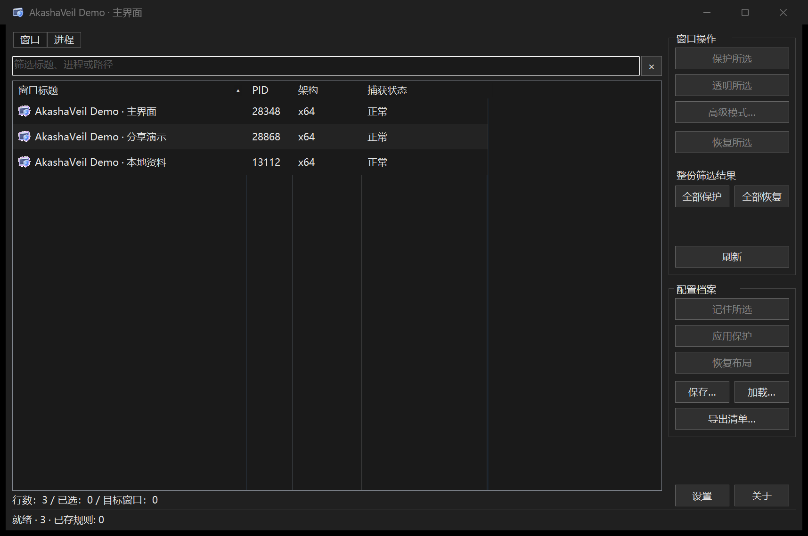
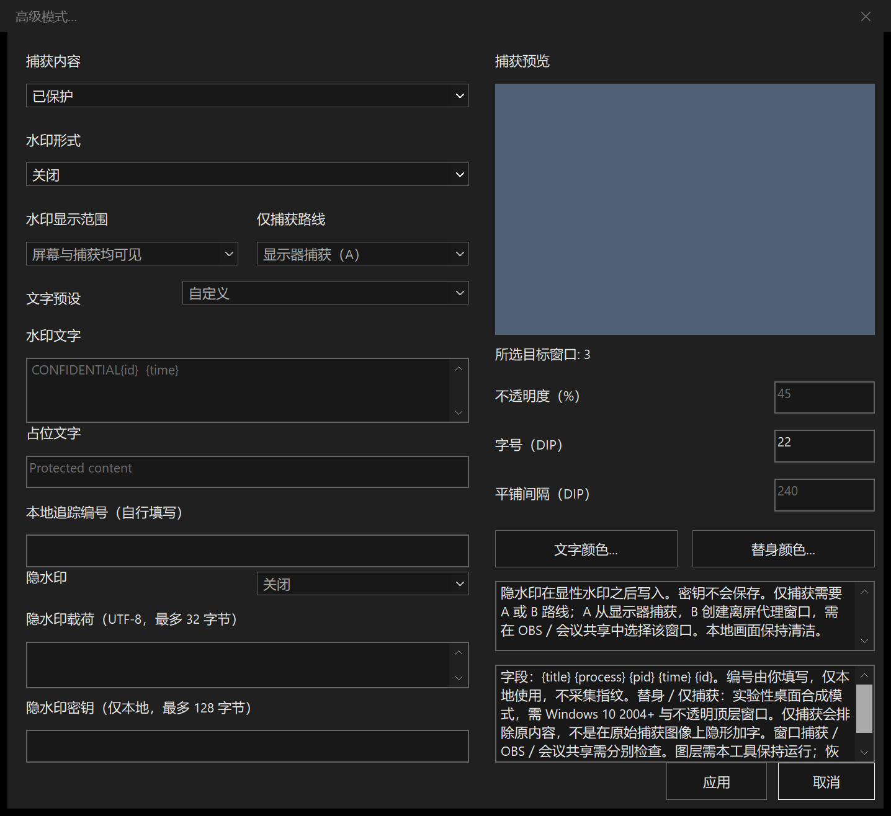
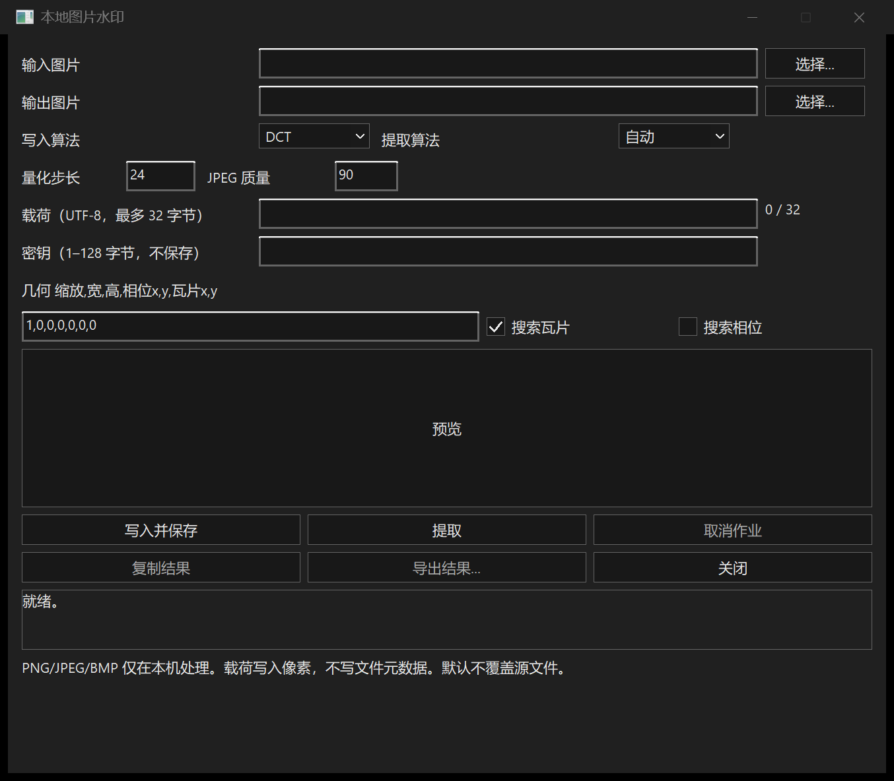

<p align="center"><a href="README.md">简体中文</a> · <b>English</b></p>

<p align="center"></p>

<h1 align="center">AkashaVeil · 凌空罩</h1>

<p align="center"><b>A local Windows window-capture protection and watermark manager.</b><br/>Protect, blank, or restore selected windows; add visible or hidden watermarks. No background networking, uploads, telemetry, or device fingerprinting.</p>

<p align="center">
  <a href="https://github.com/Henglie/AkashaVeil/releases"></a>
  <a href="LICENSE"></a>
  <a href="https://github.com/Henglie/AkashaVeil/stargazers"></a>
</p>

> [!NOTE]
> The application processes window metadata, settings, and watermark data on your computer. Its GitHub button opens your default browser only when you click it.

> [!WARNING]
> Capture protection depends on Windows, the target renderer, permissions, and the capture backend. Verify the actual screenshot or recording before relying on it. Use the tool only on devices and windows you are authorized to manage.

## Contents

- [Download](#download) · [Changelog](#changelog)
- [Features](#features) · [Screenshots](#screenshots)
- [Quick start](#quick-start) · [Command line](#command-line)
- [Keyboard shortcuts](#keyboard-shortcuts) · [Compatibility and limits](#compatibility-and-limits)
- [Build](#build) · [Privacy and local data](#privacy-and-local-data)
- [Documentation and feedback](#documentation-and-feedback) · [License](#license)

## Download

Current release: **v0.1.0**. Each EXE is self-contained; no installer, Python, Qt, or separate runtime is required.

| File | Platform |
|---|---|
| [AkashaVeil-x64.exe](https://github.com/Henglie/AkashaVeil/releases/download/v0.1.0/AkashaVeil-x64.exe) | Intel / AMD 64-bit Windows; recommended for most PCs |
| [AkashaVeil-x86.exe](https://github.com/Henglie/AkashaVeil/releases/download/v0.1.0/AkashaVeil-x86.exe) | 32-bit Windows; also runs on x64 Windows |
| [AkashaVeil-arm64.exe](https://github.com/Henglie/AkashaVeil/releases/download/v0.1.0/AkashaVeil-arm64.exe) | Windows on ARM |
| [Complete ZIP](https://github.com/Henglie/AkashaVeil/releases/download/v0.1.0/AkashaVeil-0.1.0-windows-all.zip) | All three architectures, offline documentation, license, and checksums |
| [SHA256SUMS.txt](https://github.com/Henglie/AkashaVeil/releases/download/v0.1.0/SHA256SUMS.txt) | SHA-256 checksums for release assets |

## Changelog

### 0.1.0

Development completed. First official release.

See [CHANGELOG.md](CHANGELOG.md) for the release history.

## Features

- **Native, compact UI:** Win32 / GDI+, application icons, alternating rows, filtering, column sorting, multiple selection, and refresh that preserves selection and focus.
- **Window and process views:** act on individual windows or the currently enumerated windows belonging to a process.
- **Protect / Transparent / Restore:** request system display affinity and show the state read back from Windows. “Transparent” describes captured content; it does not make the local desktop window translucent. Depending on the backend, the captured result may be blank or black.
- **Advanced mode:** original content, capture exclusion, blanking, solid replacement, or a text placeholder; tiled, centered, and corner watermarks; configurable colors, opacity, font size, spacing, and presets.
- **Local fields:** `{title}`, `{process}`, `{pid}`, `{time}`, and a user-entered `{id}`.
- **Capture-only routes:** display capture (A) or a controlled capture-source window (B). Desktop-composition replacement and capture-only modes are experimental.
- **Hidden watermarks:** DCT / QIM and DWT / Haar LH3 embedding and extraction; local PNG / JPEG / BMP workflows; payloads up to 32 UTF-8 bytes; keys are not saved in profiles.
- **Profiles and automation:** rules, program lists, geometry, state, CSV export, automatic protection / refresh, tray behavior, taskbar options, and title / tray randomization.
- **Nine UI languages:** Simplified Chinese, English, Spanish, French, Russian, Arabic (RTL), Turkish, Japanese, and Korean. Missing translations and Traditional Chinese system defaults fall back to English.
- **Light / dark / system themes**, DPI-aware layout, CLI, JSON output, and keyboard shortcuts.

## Screenshots

The screenshots use demonstration windows with the executable-path column collapsed.



| Advanced mode | Local image watermark |
|---|---|
|  |  |

[Light theme](docs/images/main-light.png)

## Quick start

1. Run the EXE for your Windows architecture.
2. Select a window or process, then use **Protect selected**, **Transparent selected**, or **Restore selected**.
3. Open **Advanced mode** with `Ctrl+W` for watermarks and replacement content. Review the preview, then apply.
4. Use **Remember selected** and **Save** to retain rules. Configure automatic protection in Preferences only when needed.
5. Verify the result using your intended capture tool. To end the application, use **Exit** in its settings or tray menu; closing the main window normally minimizes it to the tray.

## Command line

```powershell
.\AkashaVeil-x64.exe list --json
.\AkashaVeil-x64.exe protect --process 1234 --json
.\AkashaVeil-x64.exe restore --window 0x00123456 --json
.\AkashaVeil-x64.exe --version --json
.\AkashaVeil-x64.exe --profile ".\profiles\demo.ini"
```

Replace the sample PID / HWND with a current target. `list` enumerates top-level windows, including process information; it does not produce one record per unique process. HWND input is hexadecimal, with an optional `0x` prefix. `hide` / `exclude` alias `protect`, and `unhide` aliases `restore`.

Exit codes: **0** success, **2** syntax, **3** no target, **4** partial failure, **5** all failed, **6** timeout / cancellation. JSON reports should be checked together with the process exit code. CLI protection uses the system capture-affinity path; it does not configure advanced watermarks.

## Keyboard shortcuts

| Shortcut | Action |
|---|---|
| `Ctrl+H` / `Ctrl+U` | Protect / restore selected |
| `Ctrl+A` | Select all when the list has focus |
| `Ctrl+S` / `Ctrl+O` / `Ctrl+E` | Save / load profile / export list |
| `Ctrl+P` / `Ctrl+W` | Preferences / advanced mode |
| `Ctrl+F` | Focus the filter |
| `Ctrl+R` / `F5` | Refresh |
| `Esc` | Clear a focused filter; cancel / close a dialog |
| `F1` | Offline help |

## Compatibility and limits

- Windows desktop only. Windows 10 2004+ / Windows 11 is recommended. Older systems use reduced capabilities; Windows 7 does not provide `WDA_EXCLUDEFROMCAPTURE` and uses `WDA_MONITOR` with different semantics.
- Windows 7 and ARM64 binaries do not have complete target-machine validation records for this release. ARM64 cross-compilation is not a native-device test.
- An elevated target normally requires running AkashaVeil at the same privilege level. Cross-process display-affinity changes use short-lived architecture-matched helper modules and a window-thread hook. The capture-only composition pipeline does not modify the recording application.
- Desktop BitBlt results do not establish compatibility with OBS, meeting sharing, window capture, exclusive fullscreen, or every graphics renderer.
- Recovering hidden watermarks from real external screenshot / recording frames is not yet reliable enough to guarantee. Use the local image embed / extract workflow for this release.
- No kernel driver, cloud account, or complete attribution service is included. A watermark payload is not proof of identity or ownership.

## Build

Install Visual Studio C++ desktop tools, the Windows SDK, CMake, and Ninja; include x86 / x64 / ARM64 cross-compilers.

```powershell
git clone https://github.com/Henglie/AkashaVeil.git
cd AkashaVeil
.\tools\build.ps1 -Architecture all -Configuration Release
```

Output: `build/standalone/AkashaVeil-{x86,x64,arm64}.exe`. The public source tree builds without optional verification sources. The application uses static CRT; all six helper modules are embedded resources.

The approved contribution image is a private build input, not part of the source distribution. An optional `-ContributionAsset <image-path>` embeds it; builds without the asset show an unavailable message in that dialog and retain the other features.

## Privacy and local data

- No background networking, automatic updates, uploads, telemetry, or device fingerprinting.
- Default profile: `%APPDATA%/AkashaVeil/profile.ini`. Use `--profile <file>` for an explicit profile; `portable.ini` next to the EXE selects portable storage.
- Helper cache: `%LOCALAPPDATA%/AkashaVeil/Runtime/`. Embedded modules are verified before reuse. “Single EXE” does not mean no local cache files are created.
- Profiles and CSV exports can contain window titles, executable paths, and user-entered watermark payloads. Hidden-watermark keys stay in memory for the operation and are not written to the profile.
- Clicking **GitHub** in About opens the public repository in your default browser; browsing is subject to that browser's network behavior.

## Documentation and feedback

The application includes nine-language offline help (`F1`). Additional guides: [documentation index](docs/README.md), [user guide](docs/USER_GUIDE.md), [CLI / JSON](docs/CLI.md), [FAQ](docs/FAQ.md), [feature article](介绍文章.md), and [contributing](CONTRIBUTING.md).

[Report an issue](https://github.com/Henglie/AkashaVeil/issues) with the app version, Windows version, architecture, capture backend, reproduction steps, and expected / actual results. Remove private titles, paths, and keys from attachments.

## License

Apache License 2.0. See [LICENSE](LICENSE). Copyright 2026 Henglie / EternalBlaze. Voluntary support is available in About and does not unlock or restrict any feature.
