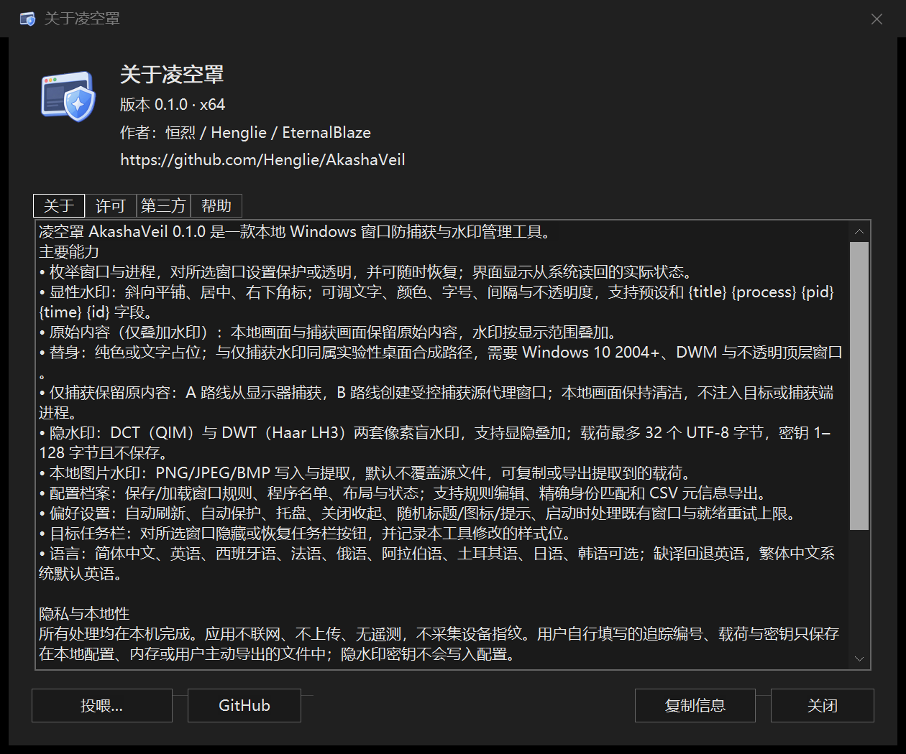

# 使用指南 · AkashaVeil 0.1.1

[文档导航](README.md) · [命令行](CLI.md) · [常见问题](FAQ.md)

## 1. 下载与首次运行

1. 从 [GitHub Releases](https://github.com/Henglie/AkashaVeil/releases/tag/v0.1.1) 下载对应架构的 EXE，或下载完整压缩包并解压。
2. 普通 Intel / AMD 64 位电脑优先运行 `AkashaVeil-x64.exe`；32 位 Windows 选 x86，Windows on ARM 选 arm64。
3. 双击运行。主界面左侧是窗口 / 进程列表，右侧是操作按钮；设置集中在右下角菜单中。
4. 管理已提权的软件时，使用同等权限运行凌空罩。失败会显示错误，不会被记作成功。

程序无需安装框架或字体包。自有跨进程辅助模块内嵌在 EXE 中，执行保护时按需释放到用户本地缓存。

## 2. 浏览与选择目标

- 用顶部页签切换窗口视图与进程视图。
- 筛选框匹配窗口标题、进程名称、路径等信息；点击列标题排序。
- `Ctrl` / `Shift` 用于原生多选，列表获得焦点后 `Ctrl+A` 全选。
- 刷新会尽量保留仍存在目标的选择、焦点与滚动位置，不把已消失对象的身份转移给新对象。
- 进程行代表当前枚举到的该进程窗口集合，不代表未来才创建的所有窗口。

“全部保护 / 全部恢复”作用于**当前筛选结果**。操作前核对底部的行数、选择数与目标窗口数。

## 3. 保护、透明与恢复

| 操作 | 含义 |
|---|---|
| 保护所选 | 请求 Windows 将目标从受支持的捕获路径中排除 |
| 透明所选 | 请求隐藏被捕获的窗口内容；后端可能显示为空白或黑色 |
| 恢复所选 | 移除本工具施加的捕获亲和性和本会话图层 |

快捷键：`Ctrl+H` 保护，`Ctrl+U` 恢复。

本机窗口通常仍保持可见。Windows 10 2004+ 提供 `WDA_EXCLUDEFROMCAPTURE`；旧系统按 `WDA_MONITOR` 分级处理，语义不同。工具显示系统读回的亲和性状态，状态成功不等于每一种录屏后端都按预期显示。

## 4. 高级模式：捕获内容与附加水印

选中目标，点击“高级模式…”或按 `Ctrl+W`。

1. **捕获内容**：原始内容、排除、透明、纯色替身或文字占位。排除 / 透明不输出原内容，水印作用于原始内容或替身。
2. **显性水印**：勾选“叠加显性水印”，设置平铺 / 居中 / 角标、文字、预设、颜色、不透明度、字号和间隔。
3. **隐水印**：独立勾选“叠加隐水印”，选择 R-DCT / DCT / DWT，输入载荷和会话密钥；可以与显性水印同时启用。
4. **输出与预览**：选择屏幕与捕获均可见，或仅捕获可见。A / B 路线仅在“仅捕获”时使用。预览示意显性布局，隐水印应通过截图提取验证。
5. 点击“应用”提交；“取消”放弃编辑。窗口水印在首个实际合成帧发布后才报告生效。

只用窗口隐水印时，保留原始内容，仅勾选“叠加隐水印”；显示范围保持自己的选择，显性水印无需开启。选择排除 / 透明时不输出原内容；纯色或文字替身目前不支持隐水印。

字段会在应用方案时展开：

| 字段 | 内容 |
|---|---|
| `{title}` | 窗口标题 |
| `{process}` | 进程名称 |
| `{pid}` | 当前进程 ID |
| `{time}` | 应用时的时间 |
| `{id}` | 自己填写的本地追踪编号 |

本地编号不是联网身份认证。不要在水印文字中放入不希望他人看到的密钥或私人信息。

### 仅捕获路线怎么选

- **A：显示器捕获**。在捕获端选择显示器 / 屏幕捕获。直接捕获原目标窗口不等同于这条路线。
- **B：受控捕获源窗口**。在捕获端选择工具提供的代理窗口；若该后端无法列出它，请改用 A 路线。

纯色替身、文字占位和仅捕获模式依赖桌面合成，属于实验性能力，需要较新的 Windows、DWM 与合适的顶层窗口。全屏、透明窗口、跨显示器以及不同渲染器应分别检查。

## 5. 本地图片隐水印

从设置菜单打开“水印提取 / 图片处理”。默认是提取页；写入图片使用另一个页签。

### 写入

1. 切换到“写入并保存”页，选择输入 PNG / JPEG / BMP 图像。
2. 选择输出路径与 R-DCT / DCT / DWT 算法。R-DCT 是默认增强路线。
3. 输入载荷和密钥，点击“写入并保存”。
4. 保存完成后，用同一个密钥执行提取，确认结果。

载荷最多 **32 个 UTF-8 字节**，不是 32 个字符。密钥为 **1–128 个 UTF-8 字节**，不会写入配置文件，应自行妥善保存。输出默认不覆盖源文件；建议首次使用选择 PNG。

### 提取

1. 在默认“提取”页选择包含水印的截图或图片。
2. 提取算法可选自动 / R-DCT / DCT / DWT，填写原始密钥。
3. 保留默认自动对齐，点击“提取”。只有缩放图等特殊输入才展开“高级参数”。
4. 成功后可复制结果或导出载荷；取消作业会请求停止后台处理。

“高级参数”中的几何参数顺序是 `缩放,原始宽,原始高,相位X,相位Y,瓦片X,瓦片Y`。默认已启用瓦片与像素相位搜索，普通截图无需填写七个数字。

| 参数 | 范围 / 含义 |
|---|---|
| DCT delta | 1–255；写入与提取应保持一致 |
| R-DCT delta | 1–255；默认 24，内部数据步长 64 / 导频步长 48；与旧 DCT 的强度不同 |
| DWT delta | 本版固定为 24 |
| JPEG 质量 | 1–100；仅影响 JPEG 输出 |
| 相位 X / Y | 0–7 |
| 瓦片 X / Y | 0–31 |

真实的带标题栏演示窗口→桌面截图→GUI 提取已验证，包括显隐叠加和两种显示范围。请使用屏幕截图或指定的代理输出；直接抓取原窗口的后端可能不包含外部叠层。若未检测到，核对密钥、截图来源，并尝试不缩放地裁剪至目标窗口。OBS / 会议视频、打印扫描、手机拍屏、任意旋转等仍需单独验证。

R-DCT 写入至少需要 **256×256** 像素。对裁剪图勾选“搜索瓦片”和“搜索相位”；对缩放图填写原始尺寸，例如原图 `768×512` 缩为 `576×384` 时使用 `0.75,768,512,0,0,0,0`。原始尺寸提示不是原图文件，也不是自动缩放检测。同步分数 R-DCT 为 `0–1000`，旧算法为 `0–32`；只有完整载荷通过纠错及校验才显示成功。详细原理、测试范围和画质代价见 [隐水印说明](WATERMARK.md)。

## 6. 记住窗口、规则与布局

- **记住所选**：把所选对象的匹配信息、保护模式与水印参数保存成规则。
- **应用保护**：按已保存规则匹配当前窗口并应用方案。
- **恢复布局**：恢复保存的位置、大小和显示状态。
- **窗口规则**：在设置菜单中添加、更新、删除、启用或停用规则。
- **保存 / 加载**：读写配置文件；**导出清单**生成当前筛选结果的 CSV 元信息。

HWND 和 PID 会随进程重启变化，不能作为跨启动身份。保存的规则通过窗口 / 程序身份信息重新匹配；同名或多个相似窗口应核对后再应用。

## 7. 偏好、自动保护与托盘

- 自动保护与自动刷新默认关闭，按需启用。
- 自动刷新间隔为 100–60000 ms；就绪重试上限为 0–60000 ms。
- 程序名单接受文件名或完整路径，可通过浏览按钮添加。
- 默认显示托盘图标，关闭主窗口时收起到托盘。使用设置菜单或托盘菜单中的“退出”结束进程。
- 标题、托盘图标和提示可随机化；隐藏本工具任务栏按钮依赖托盘入口。

“应用”保存当前偏好后，后续“取消”不会撤销已应用的值。退出会尝试恢复本会话修改的目标任务栏样式，并移除本工具图层；已经写入的捕获亲和性可能继续保留，需要时先对目标执行“恢复所选”。

## 8. 配置与便携模式

| 模式 | 配置位置 |
|---|---|
| 默认 | `%APPDATA%/AkashaVeil/profile.ini` |
| 便携 | EXE 同目录放置 `portable.ini` 标记后，使用同目录 `AkashaVeil.ini` |
| 显式路径 | `AkashaVeil-x64.exe --profile <文件>` |

程序新写 schema 4，可读取旧 schema 1/2/3。完整压缩包不携带用户配置；升级可先备份自己的 INI，再替换 EXE。配置目录需可写，损坏配置不会作为有效内容继续应用。

## 9. 关于、GitHub 与反馈

设置菜单打开“关于”；`F1` 直接打开离线帮助页。关于窗口包含许可、第三方说明和帮助，显示仓库地址，点击 **GitHub** 用默认浏览器跳转。

“复制信息”带上版本、架构、许可摘要及仓库地址，便于反馈。“投喂”完全自愿，不解锁或限制功能。

遇到问题见 [常见问题](FAQ.md)，反馈入口：[GitHub Issues](https://github.com/Henglie/AkashaVeil/issues)。
