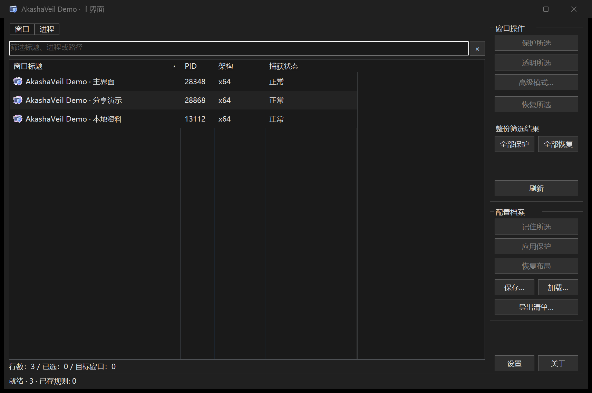
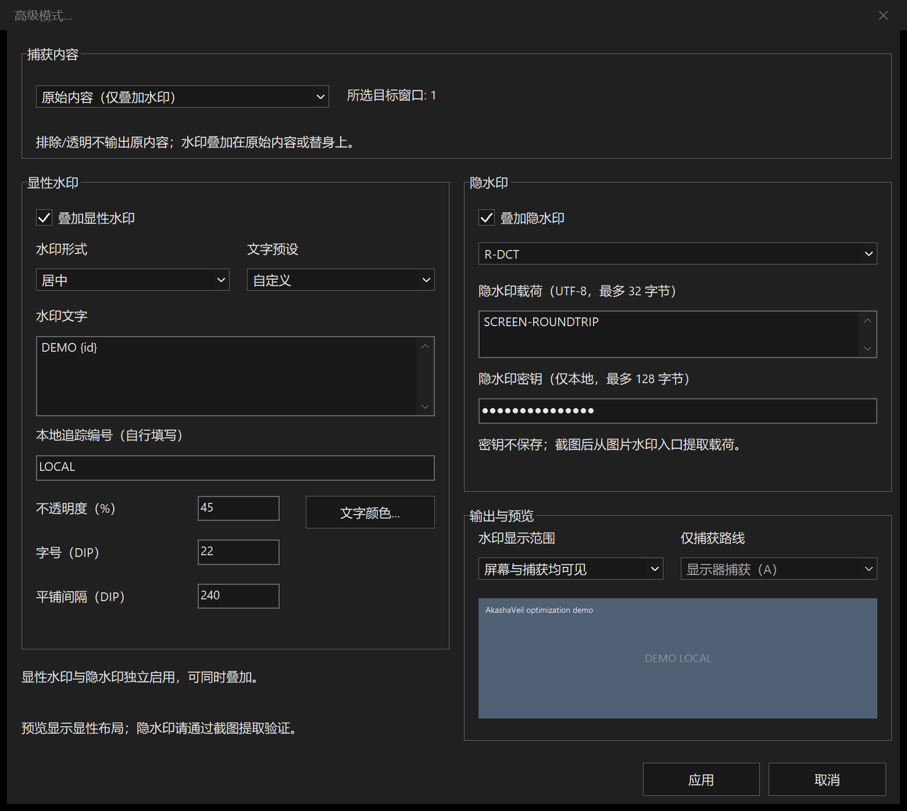
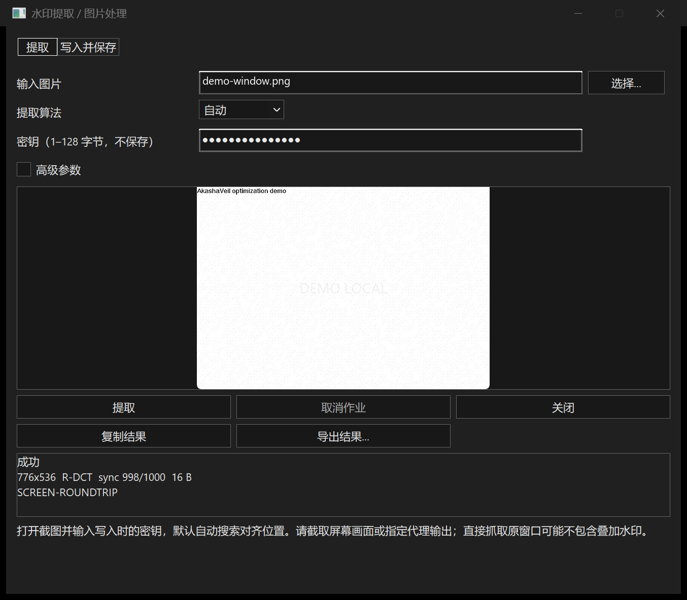

<p align="center"></p>

<h1 align="center">凌空罩 · AkashaVeil</h1>

<p align="center">
  Windows 桌面专用、纯本地的窗口防捕获与水印管理工具<br/>
  <b>枚举窗口，一键保护 / 透明 / 恢复，再把显性与隐性水印叠上去，全程不联网、不上传、不采集</b>
</p>

---

> [!NOTE]
> 这是一篇面向使用者的功能介绍。想直接上手，编译好的单文件 EXE 双击即用；想深入，往下读，每一节都会解释一个具体场景。文中的能力均以本版（0.1.0）为准，看得到的和说明书里写的一致。

[下载 v0.1.1](https://github.com/Henglie/AkashaVeil/releases/tag/v0.1.1) · [使用指南](docs/USER_GUIDE.md) · [命令行与 JSON](docs/CLI.md)

## 一、它是什么：给每一个窗口配一个"防捕获开关"

凌空罩（AkashaVeil）做的事很直接：**枚举你电脑上的窗口与进程，让你挑出想要的，然后把它们从截图 / 录屏里"摘出去"**，或者反过来，在窗口上叠一层水印。

- **窗口 / 进程双视图**：左侧列表同时看得到窗口和进程，带应用图标、隔行底色和宽松行距，点错一行的概率低一些；支持按名称、路径、PID 筛选，列排序和原生多选。
- **三种捕获状态**：**保护**（从捕获中排除）、**透明**（在捕获中呈现为透明 / 空白）、**恢复**（回到原始状态）。
- **如实显示**：工具从系统读回每个窗口真实的捕获亲和性状态，失败的行不会被标成保护成功。
- **高级模式**：不想只做"排除"时，可以编辑捕获内容、叠加水印、写入隐性水印，详见后面几节。

英文名 AkashaVeil 来自虚空（Akasha）与帷幕（Veil）的组合，中文名"凌空罩"取自同一意象——罩住窗口，隔开窥探。



## 二、为什么"纯本地"很重要

窗口防捕获这件事，处理的是你**正在使用的软件画面**：可能是一个内部系统、一份未公开的文档、一段正在直播的演示。这类信息一旦离开本机，后果往往不可逆。

因此凌空罩把"纯本地"作为硬约束，而不是一句宣传：

- **不联网、不上传**：程序不会把窗口信息、配置或水印载荷发到任何服务器。
- **不采集遥测、不采集设备指纹**：没有后台统计，没有设备指纹，没有账号。
- **所有处理在本机完成**：枚举、设置捕获亲和性、绘制水印、写入 / 提取隐性水印，都在你的机器上跑。
- **不做云端追溯**：完整追溯系统与内核驱动不在本版范围，本版采用用户态窗口保护与水印方案。

换句话说，它是一个"离线也能用、断网也不影响功能"的工具，而不是一个需要注册登录的在线服务。

## 三、保护与透明：把窗口从捕获里"摘出去"

打开程序，左侧就是窗口列表。选中一个或多个目标，点右侧的按钮即可：

- **保护**：把窗口从捕获中排除。这依赖系统的 `SetWindowDisplayAffinity`，其中 `WDA_EXCLUDEFROMCAPTURE` 从 **Windows 10 2004** 起提供；在 **Windows 7** 上按 `WDA_MONITOR` 处理，语义有所不同。
- **透明**：隐藏被捕获的窗口内容，捕获端可能显示为空白或黑色；本机窗口仍然可见。
- **恢复**：移除保护与所有图层，让窗口回到原始捕获状态。

几个实际使用中会注意到的细节：

- 对**进程行**操作，会作用于该进程当前枚举到的全部窗口。
- 快捷保护 / 透明按钮会替换该对象此前的图层方案，避免叠加出意外的效果。
- 效果最终取决于 DWM 和具体捕获后端。桌面 BitBlt 的受控测试通过，并不代表 OBS、会议共享、窗口捕获、独占全屏等后端都已经过验收——**请以实际截图 / 录像为准**。

原生多选、独立筛选、刷新保留选择与焦点，都是为了让"批量处理一堆窗口"这件事少出岔子。

## 四、高级模式：显性水印与捕获内容替换

点击**高级模式**（快捷键 `Ctrl+W`），会打开一个集中编辑窗口，把"捕获内容"和"水印"放在一起配置。



**捕获内容**可以是：

- **原始内容**：保持窗口原样，只在其上加水印。
- **排除**：从捕获中排除。
- **透明**：在捕获中透明化。
- **纯色替身**：用一个纯色块替换捕获内容。
- **文字占位**：用一段文字替换捕获内容。

**显性水印**支持三种形式：

- **斜向平铺**：整个窗口铺满斜向重复的水印。
- **居中**：单个居中水印。
- **右下角标**：右下角的角标水印。

可调参数包括**不透明度、字号、间隔、颜色**。文字支持内置预设，也支持字段占位符：

| 字段 | 含义 |
|---|---|
| `{title}` | 窗口标题 |
| `{process}` | 进程名 |
| `{pid}` | 进程 ID |
| `{time}` | 时间 |
| `{id}` | 本地追踪编号（自行填写） |

**显示范围**分两种：**屏幕与捕获均可见**（你自己和捕获端都能看到水印）与**仅捕获可见**（只在捕获中出现）。编辑时可以随时查看**捕获预览**，确认效果后再应用。

## 五、隐性水印与仅捕获路线：A / B 两条路

如果希望水印"存在但肉眼看不见"，进入隐性水印：

- **R-DCT 增强路线**、**DCT（QIM）** 与 **DWT（Haar LH3）** 三种算法，支持写入与提取。R-DCT 使用分布式密钥导频、空间交织及软判决纠错，重点增强压缩、裁剪后的恢复；保留原生轻量单 EXE。
- **本地图片水印**：用一张本地图片作为水印载体。
- **仅用于当前操作的密钥**与最多 **32 个 UTF-8 字节的载荷**，密钥不保存到配置。
- 显性水印与隐性水印**可以叠加**：看得到的负责威慑，看不到的负责追踪。

"仅捕获"场景下，程序提供两条互不注入的路线：

- **A · 显示器捕获路线**：在原内容之上叠加本地清洁层，配合显示捕获。
- **B · 受控捕获源代理窗口**：用一个离屏 / 遮挡的代理窗口承载替换内容，由捕获端选择该窗口作为源。

这两条画面合成路线不修改捕获软件；若捕获端无法列出受控源窗口，可手动改用 A。基础的跨进程捕获亲和性设置则使用架构匹配的短时辅助模块与窗口线程钩子，具体说明见 [常见问题](docs/FAQ.md)。

高级模式按捕获内容、显性水印、隐水印、输出与预览四块编组，显隐分别勾选并可叠加，显示范围独立选择。“水印提取 / 图片处理”默认打开提取页，输入截图与密钥即可自动搜索对齐；写入图片和技术参数分别放到独立页签与折叠区。

0.1.1 的 R-DCT 已在受控桌面 BitBlt 捕获中恢复载荷，并通过独立图片变换测试；这不代表 OBS、会议视频或手机拍屏全后端通过。写入至少需要 256×256 像素，增强强度会增加细微纹理；缩放图需提供原始尺寸。参数、画质与边界见[隐水印说明](docs/WATERMARK.md)。



## 六、档案、名单与自动化

凌空罩不只是"点一下、设置一次"。它可以把你的意图保存下来，下次自动执行：

- **窗口规则**：保存每个对象的模式与水印参数，重启后按**精确身份**重新匹配并恢复。
- **程序名单**：按文件名 / 完整路径维护名单，配合自动保护使用。
- **布局与状态**：保存窗口的位置、大小与状态，需要时恢复布局。
- **CSV 导出**：把窗口元信息导出为 CSV，便于留档或交给其他工具处理。

偏好设置里还能开启：

- **自动刷新**与刷新间隔。
- 按**规则 / 程序名单自动保护**（默认关闭，需手动开启）。
- **就绪失败重试上限**。
- **托盘**、**关闭收起到托盘**、**隐藏本工具的任务栏按钮**。
- **标题 / 托盘图标 / 提示随机化**。

默认显示托盘图标，关闭窗口时收起到托盘；真正退出请用设置菜单或托盘菜单里的**退出**。自动保护与自动刷新默认关闭，不会在你不注意时"自己动起来"。

## 七、九语界面与阿拉伯语 RTL

界面支持**九种语言**：

简体中文、英语、西班牙语、法语、俄语、阿拉伯语、土耳其语、日语、韩语。

- **阿拉伯语**提供从右到左（RTL）布局，方向感知的图标会同步翻转。
- **缺译回退英语**；在**繁体中文系统**上默认回退英语。
- **明暗 / 系统主题**与**主题色**可调，并会持久化。

对中文用户是母语界面，对多语言环境则是一致的体验。

## 八、键盘快捷键：常用操作一只手

| 快捷键 | 作用 |
|---|---|
| `Ctrl+H` | 保护所选 |
| `Ctrl+U` | 恢复所选 |
| `Ctrl+A` | 全选 |
| `Ctrl+S` | 保存配置 |
| `Ctrl+O` | 加载配置 |
| `Ctrl+E` | 导出清单 |
| `Ctrl+P` | 偏好设置 |
| `Ctrl+W` | 高级模式 |
| `Ctrl+F` | 筛选 |
| `Ctrl+R` / `F5` | 刷新 |
| `Esc` | 清空筛选 |
| `F1` | 帮助 |

`F1` 会直接打开帮助页，把用法、字段与边界讲清楚。

## 九、命令行：给脚本和 AI 准备的入口

除了图形界面，本版新增了**命令行接口**，让凌空罩可以被脚本、批处理甚至 AI 调用：

```text
AkashaVeil list [--json]
AkashaVeil protect --process <PID> [--json]
AkashaVeil protect --window  <HWND> [--json]
AkashaVeil restore --process <PID> [--json]
AkashaVeil restore --window  <HWND> [--json]
AkashaVeil --version [--json]
AkashaVeil --profile <配置文件>
```

- `hide` / `unhide` 是 `protect` / `restore` 的别名。
- 加 `--json` 后输出结构化结果，方便程序解析。
- 退出码区分结果：

| 码 | 含义 |
|---:|---|
| 0 | 成功 |
| 2 | 语法错误 |
| 3 | 无目标 |
| 4 | 部分失败 |
| 5 | 全部失败 |
| 6 | 超时或取消 |

这意味着你可以把"给某个进程加上保护"写进启动脚本，也可以让自动化流程根据退出码判断成败，而不必依赖界面操作。

## 十、平台与架构：三个单 EXE

凌空罩专为 Windows 桌面设计，**Windows 7 起分级支持**，发行三个各自独立的单文件：

| 架构 | 产物 |
|---|---|
| x86 | `AkashaVeil-x86.exe` |
| x64 | `AkashaVeil-x64.exe` |
| ARM64 | `AkashaVeil-arm64.exe` |

- 采用**静态 CRT**，运行只依赖 Windows 系统 DLL；自有辅助模块内嵌在 EXE 中，按需释放到本地缓存，分发目录只需一个文件。
- 构建命令：

  ```powershell
   ./tools/build.ps1 -Architecture all -Configuration Release
  ```

- `WDA_EXCLUDEFROMCAPTURE` 需要 Windows 10 2004 及以上；Windows 7 按 `WDA_MONITOR` 处理。
- Windows 7 / ARM64 本版没有完整目标真机验证记录。优先在 Windows 10 2004+ / Windows 11 使用，并用实际捕获后端验证效果。

## 十一、隐私：没有云端，没有遥测

再强调一次，因为它是这个项目的立身之本：

- 程序运行期间**不联网、不上传、不采集遥测、不采集设备指纹**。
- 窗口与进程元信息、用户配置和水印载荷只保存在本机；隐水印密钥仅在当前操作中使用，不写入配置。
- 不建立账号系统，不提供云端追溯，不把数据交给第三方。
- 投喂（赞助）入口使用产品负责人指定的本地图片；该图片**仅随私有构建内嵌**，公开源码不含私有路径或联系方式。
- 关于页提供仓库地址与 **GitHub** 按钮。主动点击时才打开默认浏览器，没有后台联网更新。

## 十二、适合哪些场景

- **演示前整理窗口**：选定需要保护的窗口，使用目标会议软件检查实际共享画面。
- **给本地文档窗口加显性水印**：用平铺 / 居中 / 角标展示用途、时间或自己填写的编号。
- **本地图片写入与提取载荷**：使用 PNG / JPEG / BMP 与同一个密钥完成隐水印工作流。
- **重复管理一组窗口**：保存规则、程序名单和布局，通过配置与快捷键减少重复操作。
- **脚本自动化**：用 CLI 枚举目标，处理 JSON 和退出码，避免依赖屏幕坐标点击。

它不提供防拍照能力、不承诺所有录屏后端生效，也没有联网身份追溯服务。**把窗口防捕获与水印合在一个本地工具中，并把边界说明白，是这个版本的定位。**

## 十三、开源许可与投喂

- **协议**：Apache License 2.0，可自由使用、修改与再分发，详见仓库根目录 `LICENSE`。
- **作者**：恒烈 / Henglie / EternalBlaze。
- **非营利**：项目不营利，程序内设有投喂（赞助）入口，用于支持后续维护。
- **反馈**：使用中遇到问题或建议，欢迎通过项目仓库的 Issue 反馈。

<p align="center"><b>罩住窗口，隔开窥探——纯本地，不联网，把防捕获和水印留在一台机器里。</b></p>
