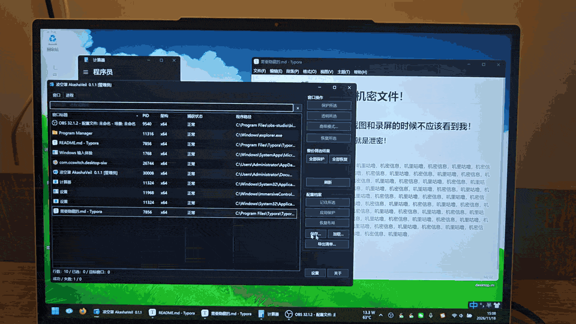
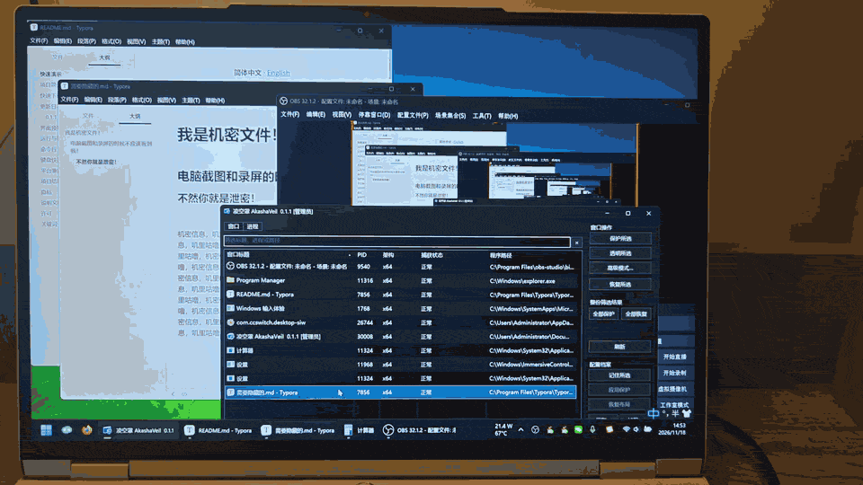
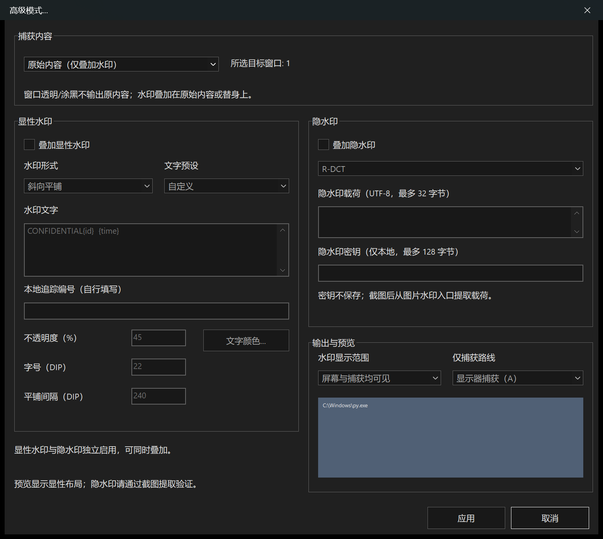

<h1 align="center">凌空罩 · AkashaVeil</h1>

<b>截图拍不到，录屏录不到。你指哪个窗口，就保护哪个窗口。</b>

---

## 它解决什么问题

上网课、开会、演示、录视频的时候，屏幕上总会冒出一些不想被拍进去的窗口。

凌空罩做的事情很简单：**你指定一个窗口，它就从截图和录屏里消失。** 本地电脑上你还能正常看到，截图和录屏里只剩背景；反过来，也可以让它变成黑块。

**截图演示：窗口直接消失**

**录屏演示：画面里不会出现窗口**

## 三个好用的地方

**一、点一下就能用**

打开程序，列表里选窗口，点**“保护所选”**。**就能看到效果啦啊！！！**

**二、不用翻列表找窗口**

按住“设置 / 关于”上方的**瞄准图标**，拖到目标窗口上松开，就选中了！！然后就是点击保护所选。

**三、保护方式自己选**

默认是**“窗口透明”**，截图里只剩背景；也可以在右侧**“默认保护方案”**里改成**“窗口涂黑”**，让它变成黑块。

选中窗口后点“恢复所选”就能取消保护。

<b>还想玩点花的？</b>

点“高级模式”，可以把捕获画面换成纯色、换成一段文字，也可以在画面上叠加显性水印，或者写入看不见的隐水印。水印用于自己追踪截图来源，密钥只留在本机。

## 干什么用的？

首先嘛，作者也没想到具体有什么非常实用的正经用途。

我想到的用途都不太正经。。。。。

如果你有正经用途，你可以发在评论区。

## 下载

当前发布版本：**v0.1.2**。下载后直接运行，选择和你电脑对应的版本即可。

| 下载 | 说明 |
|---|---|
| [百度网盘](https://pan.baidu.com/s/1mmNK-2tSO4c_0qTj_HCILA?pwd=0000) | 提取码 `0000` |
| [夸克网盘](https://pan.quark.cn/s/b0bc1b050888) | 国内备用 |
| [GitHub Releases](https://github.com/Henglie/AkashaVeil/releases) | 官方发布页，含 x86 / x64 / ARM64 和完整压缩包 |
| [项目源码](https://github.com/Henglie/AkashaVeil) | GitHub 仓库，欢迎 Star |

普通 64 位 Windows 选 `AkashaVeil-x64.exe`；32 位系统选 x86；ARM 设备选 arm64。

## 使用步骤

1. 打开凌空罩。
2. 在列表里选窗口，或者按住“设置 / 关于”上方的瞄准图标拖到目标窗口。
3. 点“保护所选”。
4. 打开截图或录屏软件，实际看一眼效果。
5. 不想要保护了，点“恢复所选”。

如果想将已保护的窗口从涂黑改为透明，在右侧 **默认保护方案** 里改成“窗口透明”，再对目标窗口点击“保护所选”。

## 说明

- 纯本地运行，不联网、不上传、不采集。
- Windows 7 起可用，推荐 Windows 10 / 11。
- 不同截图、录屏软件的支持程度不一样，请以实际画面为准。
- 本项目认可 [Linux.do 社区](https://linux.do)。
- Apache License 2.0，作者：恒烈 / Henglie / EternalBlaze。
- GitHub仓库：https://github.com/Henglie/AkashaVeil
